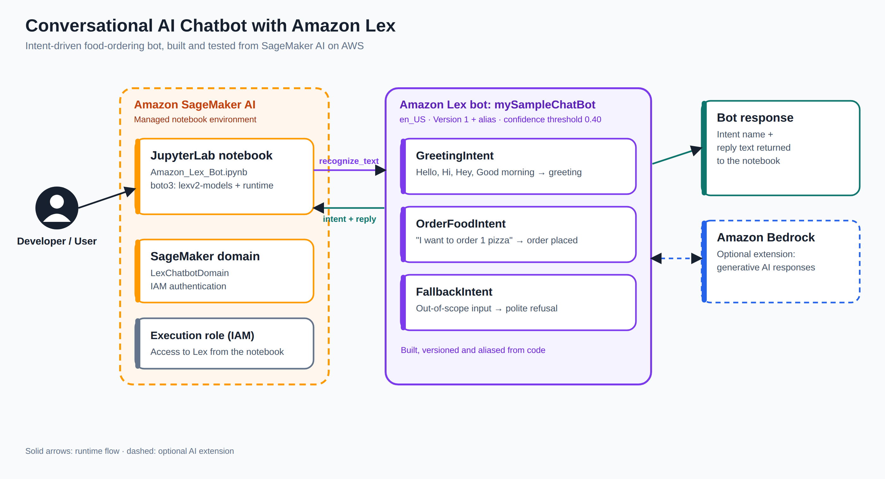
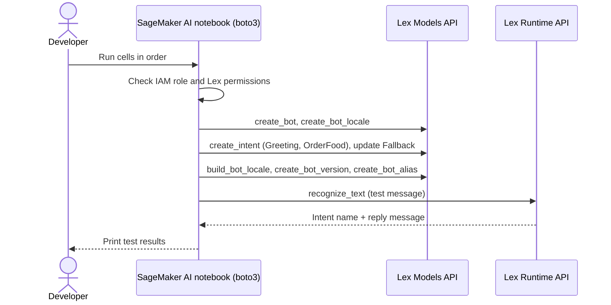
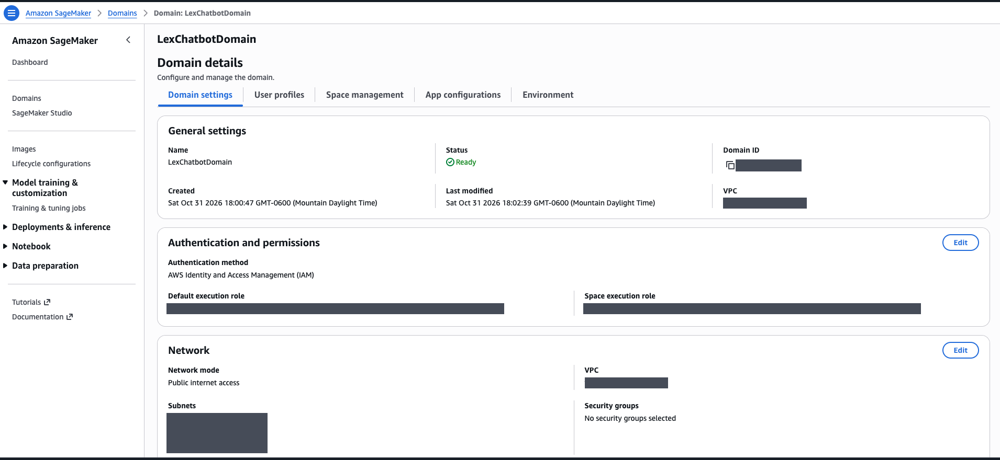
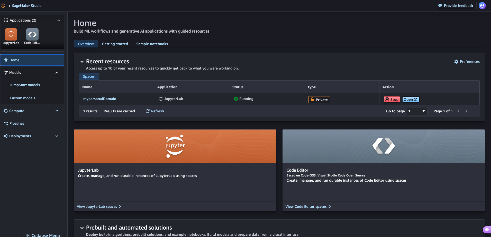
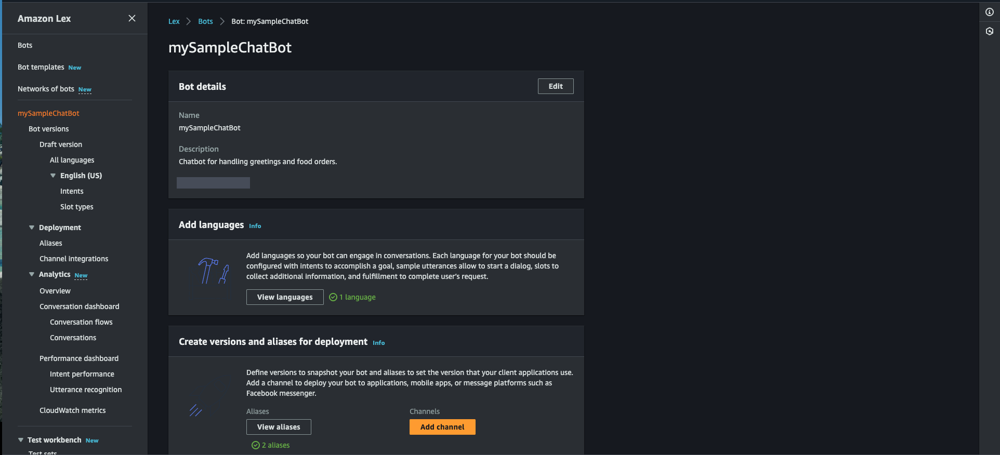
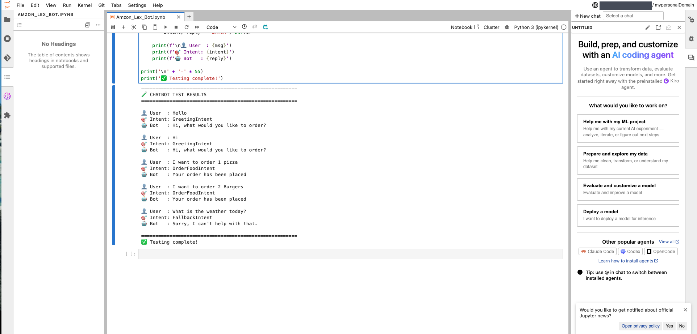

# Conversational AI Chatbot with Amazon Lex

A food-ordering chatbot built with **Amazon Lex V2** and **Amazon SageMaker AI** on AWS. The whole bot is created, built, versioned and tested from code with **boto3**, and **Amazon Bedrock** is the natural next step for generative AI responses.

The bot, `mySampleChatBot`, greets customers, takes food orders and politely declines anything outside its scope. A Python notebook in SageMaker AI Studio checks IAM permissions, creates the bot and its intents, builds it, publishes a version and alias, and then sends test messages and prints the detected intent and reply.



---

## What is Amazon Lex?

Amazon Lex is a fully managed AWS service for building conversational interfaces with text and voice. It uses the same deep learning technologies that power Alexa: automatic speech recognition (ASR) to turn speech into text, and natural language understanding (NLU) to work out what the user wants.

Key concepts used in Lex:

| Concept | Meaning |
|---|---|
| **Bot** | The conversational application, for example `mySampleChatBot` |
| **Intent** | The goal behind what the user says, such as greeting or ordering food |
| **Utterance** | A sample phrase that triggers an intent, such as "I want to order 1 pizza" |
| **Slot** | A piece of information to collect, such as item or quantity |
| **Fallback intent** | Handles input that matches no other intent |
| **Version and alias** | A snapshot of the bot and a pointer client apps use to call it |
| **Channel** | Where the bot is deployed: apps, websites, messaging platforms |

---

## What I Built

| Layer | Details |
|---|---|
| **Bot** | `mySampleChatBot`: "Chatbot for handling greetings and food orders" (region `us-east-1`, locale `en_US`) |
| **Intents** | `GreetingIntent`, `OrderFoodIntent` with sample utterances, plus a configured `FallbackIntent` |
| **NLU settings** | Intent confidence threshold 0.40, idle session timeout 300 seconds |
| **Deployment** | Bot built from the draft, published as version 1, with a test alias |
| **Environment** | Amazon SageMaker AI domain `LexChatbotDomain` with a JupyterLab space |
| **Automation** | `Amazon_Lex_Bot.ipynb`: boto3 clients for `lexv2-models` and `lexv2-runtime`, with idempotent create steps that reuse existing resources |
| **Security** | Notebook verifies Lex permissions and that the execution role trusts `lexv2.amazonaws.com` before creating anything |
| **Next step** | Amazon Bedrock for generative responses on top of the intent flow |


| **Bot** | `mySampleChatBot`: "Chatbot for handling greetings and food orders", English (US), 2 aliases |
| **Intents** | `GreetingIntent`, `OrderFoodIntent`, `FallbackIntent` |
| **Environment** | Amazon SageMaker AI domain `LexChatbotDomain` with a JupyterLab space |
| **Test client** | `Amazon_Lex_Bot.ipynb`, a Python 3 notebook that sends utterances and prints intent and reply |
| **Generative AI** | Amazon Bedrock enabled in the same AWS account |
| **Access** | IAM authentication and an execution role for the SageMaker domain |

---

## Architecture



---

## Step 1: Set up the SageMaker AI environment

I created a SageMaker AI domain named `LexChatbotDomain` (status Ready, IAM authentication, public internet access) and launched a private JupyterLab space from SageMaker Studio.





---

## Step 2: Create the Amazon Lex bot from code

Instead of clicking through the console, the notebook creates everything with boto3. The Lex console then shows the result: `mySampleChatBot` in English (US) with its intents, versions and aliases.



The notebook runs these stages in order:

| # | Stage | What it does |
|---|---|---|
| 0 | Setup | Installs and imports boto3, creates `lexv2-models`, `lexv2-runtime`, STS and IAM clients |
| 1 | Permission check | Finds the SageMaker execution role, confirms Lex permissions and the `lexv2.amazonaws.com` trust relationship |
| 2 | Create bot | Creates `mySampleChatBot` (or reuses it) and waits until it is Available |
| 3 | Locale | Adds the `en_US` locale with a 0.40 NLU confidence threshold |
| 4 | Intents | Creates `GreetingIntent` and `OrderFoodIntent` with sample utterances and replies |
| 5 | Fallback | Configures `FallbackIntent` with a polite refusal |
| 6 | Build | Builds the bot locale and waits for the Built status |
| 7 | Publish | Creates version 1 and an alias for testing |
| 8 | Test | Sends sample messages through `recognize_text` |

| Intent | Sample utterances | Reply |
|---|---|---|
| `GreetingIntent` | Hello, Hi, Hai, Hey, Good morning | Hi, what would you like to order? |
| `OrderFoodIntent` | I want to order 1 pizza, I want to order 2 Burgers, Can I order food, I would like to order, Please take my order | Your order has been placed |
| `FallbackIntent` | Anything that matches no other intent | Sorry, I can't help with that. |

---

## Step 3: Test the bot from the notebook

Each test message is sent to the bot alias with `recognize_text`. The notebook prints the user message, the detected intent and the reply.

```python
r = runtime_client.recognize_text(
    botId=BOT_ID, botAliasId=BOT_ALIAS_ID, localeId=LOCALE_ID,
    sessionId=f'test-session-{i}', text=msg
)
intent = r['sessionState'].get('intent', {}).get('name', 'N/A')
reply = r['messages'][0]['content']
```



| User message | Detected intent | Bot reply |
|---|---|---|
| Hello | GreetingIntent | Hi, what would you like to order? |
| Hi | GreetingIntent | Hi, what would you like to order? |
| I want to order 1 pizza | OrderFoodIntent | Your order has been placed |
| I want to order 2 Burgers | OrderFoodIntent | Your order has been placed |
| What is the weather today? | FallbackIntent | Sorry, I can't help with that. |

All five test cases were classified into the expected intent.

---

## Getting Started

1. Clone this repository
   ```bash
   git clone https://github.com/oveskhan86/<your-repo-name>.git
   ```
2. In the AWS console, open **Amazon SageMaker AI**, create a domain and launch JupyterLab.
3. Attach a policy to the SageMaker execution role that allows Amazon Lex V2 actions and `iam:PassRole`, and add `lexv2.amazonaws.com` to the role's trust relationship.
4. Upload `Amazon_Lex_Bot.ipynb`, set `REGION` if you do not use `us-east-1`, and run the cells in order.
5. Confirm the test cell prints the expected intent and reply for each message.

> The notebook in this repository has account IDs, role names, bot IDs and alias IDs replaced with placeholders. Never commit real identifiers or credentials.

---

## Clean Up

To avoid charges, delete the Lex bot, its alias and version, stop and delete the SageMaker AI JupyterLab space, and remove the domain when you are finished.

---

## Skills Demonstrated

`Conversational AI` · `Amazon Lex` · `Intent design and NLU` · `Amazon SageMaker AI` · `boto3 / AWS SDK for Python` · `AWS IAM` · `Jupyter` · `Python` · `Chatbot testing` · `Amazon Bedrock (planned extension)`

---

## Author

**Oves Khan** · AI Engineer
[LinkedIn](https://www.linkedin.com/in/oves-khan) · [GitHub](https://github.com/oveskhan86)
